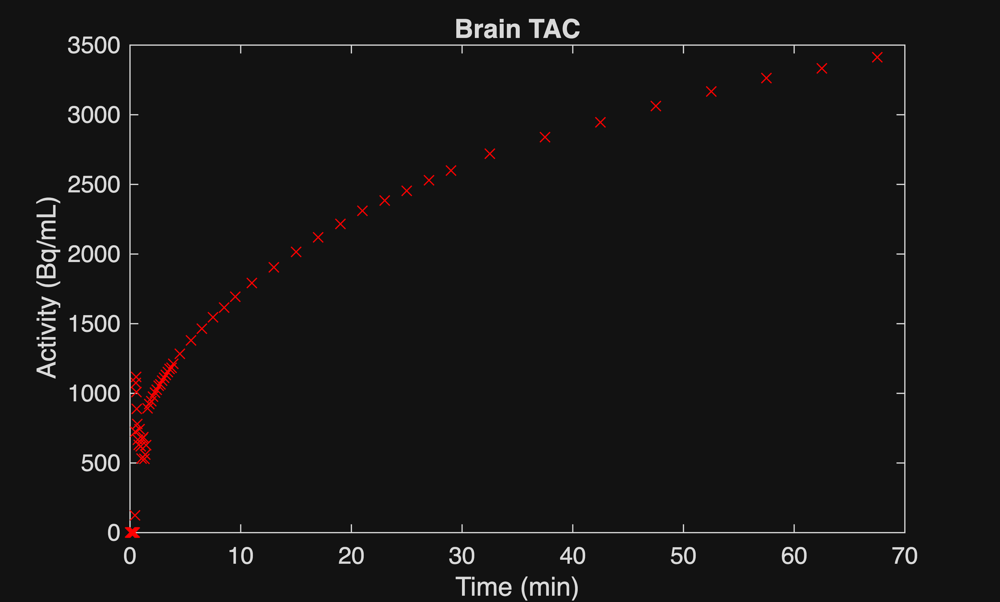
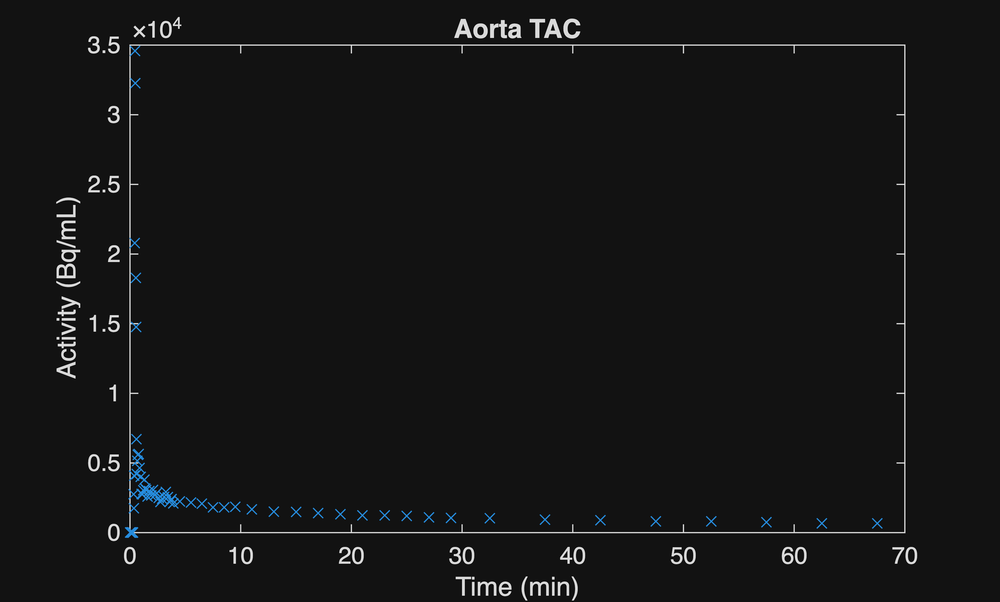
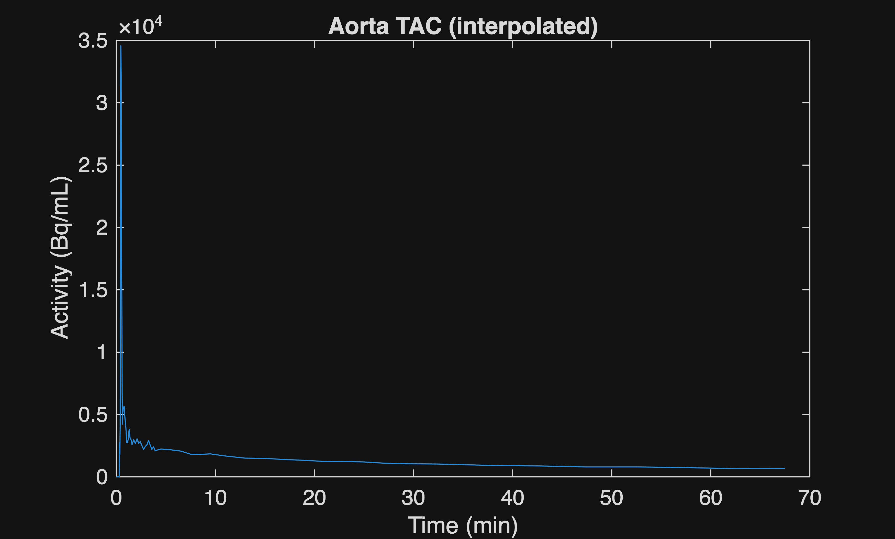
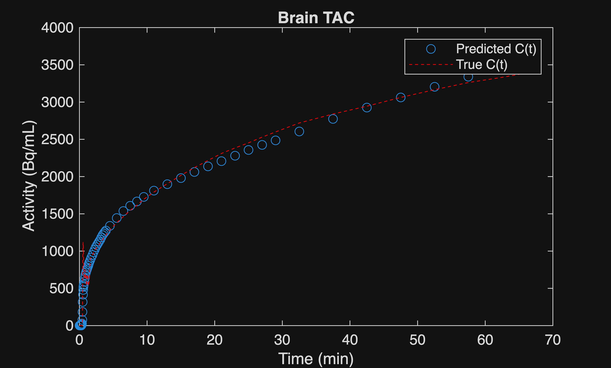

# Introduction

In this project, the Healthy Dynamic PET (hedyPET) dataset containing \[F\-18\]FDG dynamic PET/CT of 100 healthy humans was used (Hinge et al., 2026). The provided time\-activity curves (TAC) as well as image\-derived input function (IDIF) in this dataset were used to calculate the net\-influx rate (Ki) for the brain through compartmental modeling. MATLAB was used for all data processing and analysis.

Dataset source: [https://doi.org/10.1038/s41597\-026\-08157\-4](https://doi.org/10.1038/s41597-026-08157-4)

# Load pre\-extracted data

The time activity curve (TAC) measurements for the brain, the image\-derived arterial input function (AIF), and the Patlak Ki values provided in the dataset were already extracted in a previous project and are simply loaded here.

```matlab
clearvars
load brainTACdata.mat;
load trueKi.mat;
load IDIF.mat;
```

The following are plots of the activity concentration versus time measurements for the brain and the ascending aorta (the AIF).

```matlab
time_points = brainTACdata.("Frame Time Middle [s]");
brainCtrue = brainTACdata.("PET Mean [Bq/mL]"); %true activity concentration in brain
plot(time_points, brainCtrue, 'rx');
title('Brain TAC')
xlabel('Time (min)')
ylabel('Activity (Bq/mL)')
```



```matlab
aortaTAC = sub000IDIFdata.("PET Mean [Bq/mL]");
plot(time_points, aortaTAC,'x');
xlabel('Time (min)')
ylabel('Activity (Bq/mL)')
title('Aorta TAC')
```



```matlab
AIF = fit(time_points, sub000IDIFdata.("PET Mean [Bq/mL]"), 'pchipinterp'); %fit a piecewise function by interpolation
plot(time_points, feval(AIF, time_points))
xlabel('Time (min)')
ylabel('Activity (Bq/mL)')
title('Aorta TAC (interpolated)')
```



# Estimating the net influx rate (Ki) by compartmental modeling.

The differential equations governing the kinetics of \[F\-18\]FDG using the irreversible two\-tissue compartment model are as follows:

 $$ \frac{{\mathrm{d}\mathrm{C}}_1 \left(t\right)}{\mathrm{d}\mathrm{t}}=K_1 A\left(t\right)-\left(k_2 +k_3 \right)C_1 \left(t\right) $$ 

 $$ \frac{{\mathrm{d}\mathrm{C}}_2 \left(t\right)}{\mathrm{d}\mathrm{t}}=k_3 C_1 \left(t\right) $$ 

The solution to this system of ODEs is:

 $$ C\left(t\right)=\frac{K_{1\;} }{k_2 +k_3 }\left\lbrack k_3 +k_2 e^{-\left(k_2 +k_3 \right)t} \right\rbrack \otimes A\left(t\right) $$ 

# Representing the solution to the 2TCM in code

The concentration in tissue (C(t)) is approximated by trapezoidal integration instead of a convolution.

```matlab
%Function to predict C at t = tau(end), the last element of the vector tau
function Cpred = predictC(k, tdata, AIF)
B = @(k, tau) k(1)/(k(2) + k(3)) * (k(3) + k(2) * exp(-(k(2) + k(3)) * (tau(end) - tau))); %tau(end) is a single time point for which C(t) will be evaluated while tau is a set of time points from 0 to tau(end)
A = @(tau) AIF(tau); %evaluate the interpolated AIF from tau = 0 to tau = t
BxA = @(k, tau) B(k, tau) .* A(tau); %multiply B with A at each point from tau = 0 to tau = t
areaBxA = @(k, tau) trapz(tau, BxA(k, tau)); %finds the area under the curve of BxA from tau = 0 to tau = t. tau should be a vector from time = 0 to time = t with each point corresponding to an element of tau


n = numel(tdata);
Cpred = zeros(n,1);


%loop through each element of xdata which should consist of the time points from 0 to t with each point corresponding to an element of time_points
for idx = 1:n
    tpoints = tdata(1:idx);
    tau = [0; tpoints];
    Cpred(idx) = areaBxA(k, tau);
end
end
```

# Estimating the kinetic parameters ( $K_1 ,k_2 ,k_3$ ) and Ki by nonlinear curve fitting.

The code below attempts to estimate the values of k1, k2, and k3 by by minimizing the sum of squares between the predicted and true concentration values in tissue.

```matlab
%Function to calculate the sum of squares between C predictions and true C
function weightedSS = fitSS(k, time_points, AIF, Ctrue)
    Cpred = predictC(k, time_points, AIF);
    squares = (Cpred - Ctrue).^2;
    weightedSS = sum(squares);
end


%Perform a search for the global minimum of the sum of squares for the brain predictions
brainOptProblem = createOptimProblem("fmincon",...
    objective=@(k) fitSS(k, time_points, AIF, brainCtrue),...
    x0 = rand(3,1) .* 0.1,...
    lb = [0; 0; 0], ...
    ub = [5; 5; 1], ...
    options = optimoptions(@fmincon, Algorithm="sqp",...
    Display = "off"));


gs = GlobalSearch( ...
    NumTrialPoints = 5000, ...
    NumStageOnePoints = 500);


[brainkEst, brainSS] = run(gs, brainOptProblem);
```

```matlabTextOutput
GlobalSearch stopped because it analyzed all the trial points.


All 72 local solver runs converged with a positive local solver exit flag.
```

```matlab
brainKi = (brainkEst(1) * brainkEst(3))/(brainkEst(2) + brainkEst(3)); %calculation of brain Ki using the microparameters K1, k2, and k3
```

# Validation of results

The values predicted by the 2TCM solution (Cpred) approximated using trapezoidal integration combined with the estimated kinetic parameters are plotted. The percent error between the calculated Ki and the "true" Ki provided in the dataset is calculated as well. 

```matlab
brainCpredictions = predictC(brainkEst, time_points, AIF); %predicted activity concentration in brain;
plot(time_points, brainCpredictions, 'o');
xlabel('Time (min)')
ylabel('Activity (Bq/mL)')
hold on
plot(time_points,brainCtrue,'r--');
hold off
legend('Predicted C(t)', 'True C(t)');
title('Brain TAC')
```



```matlab
brainError = (brainKi-truebrainKi)/truebrainKi*100;
brainresults = table(brainKi, truebrainKi, brainError, VariableNames=["Predicted Brain Ki" "True Brain Ki" "% error"]);
disp(brainresults);
```

```matlabTextOutput
    Predicted Brain Ki    True Brain Ki    % error
    __________________    _____________    _______


         0.039187            0.03452       13.518 
```